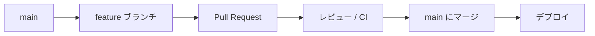

# コントリビューションガイド

## GitHub Flow

このプロジェクトは [GitHub Flow](https://docs.github.com/ja/get-started/using-github/github-flow) に従います。



### 手順

1. `main` を最新化する  
   `git checkout main && git pull origin main`
2. 作業ブランチを作成する  
   `git checkout -b feature/your-topic`
3. 変更をコミットする（小さく、意味のある単位で）
4. push して Pull Request を開く  
   `git push -u origin feature/your-topic`
5. CI が成功することを確認する
6. レビュー後、`main` に **Squash merge** する
7. マージ後、feature ブランチを削除する

### ブランチ命名例

| 種別 | 例 |
|------|-----|
| 機能 | `feature/add-portal-foo` |
| 修正 | `fix/ckan-url-resolution` |
| ドキュメント | `docs/update-readme` |

### `main` ブランチの保護（推奨）

リポジトリ管理者は GitHub 上で次を設定してください。

**Settings → Branches → Branch protection rules → `main`**

- Require a pull request before merging
- Require status checks to pass（`CI` ワークフロー）
- Do not allow bypassing the above settings（推奨）

CLI で設定する例（管理者権限が必要）:

```bash
gh api repos/{owner}/{repo}/rulesets -X POST -f name='main protection' ...
```

詳細は [GitHub ドキュメント](https://docs.github.com/ja/repositories/configuring-branches-and-merges-in-your-repository/managing-protected-branches/about-protected-branches) を参照してください。

## ローカルチェック

PR 作成前に以下を実行してください。

```bash
npm ci
npm run check
```

## シークレット

- `ADMIN_TOKEN` や API キーをコミットしない
- 本番値は `wrangler secret put` または GitHub Actions Secrets で管理する
